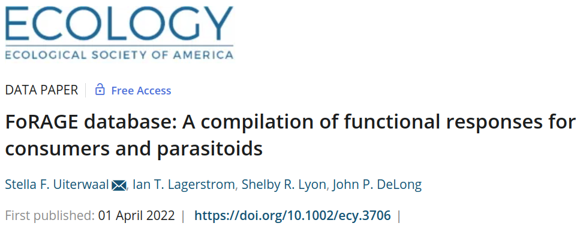
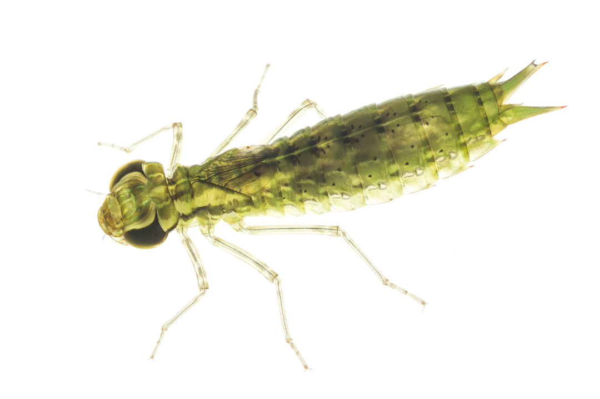
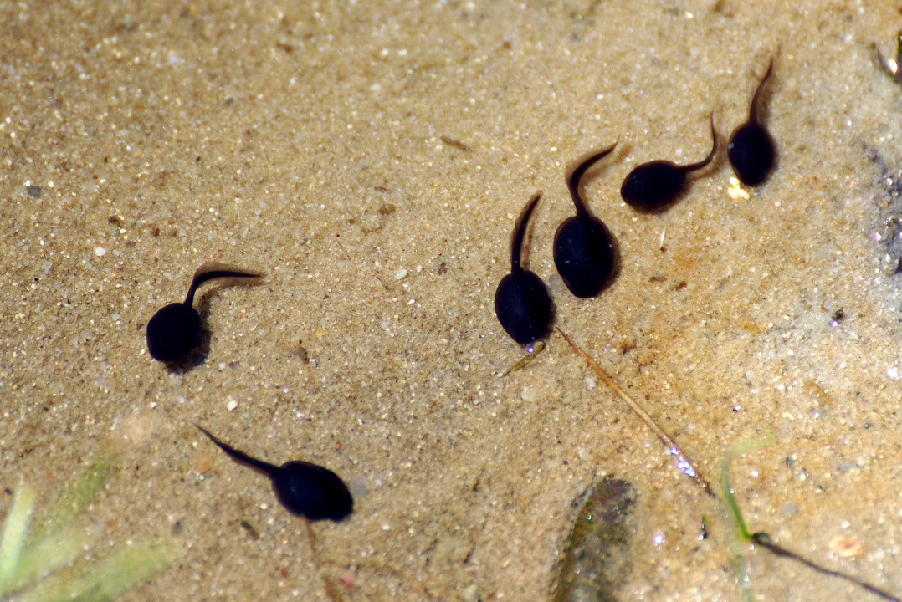
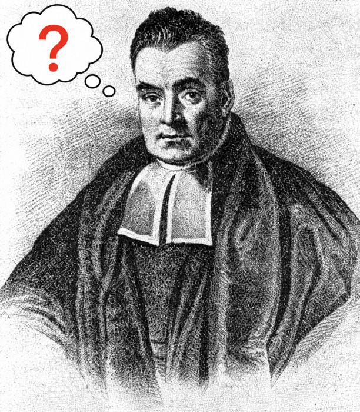

```{r}
#| label: setup
#| echo: FALSE
#| output: FALSE
library(brms)
library(ggplot2)
library(dplyr)
library(BayesFR)
theme_set(theme_bw(base_size = 24))
options(width = 120)
highlight_colors <- list(
  high_bg     = "#fdecea",
  high_border = "#d62728",
  mid_bg      = "#fff3cd",
  mid_border  = "#E69F00",
  low_bg      = "#edf2f7",
  low_border  = "#4a6fa5"
)
```


## About me 

:::: {.columns}

::: {.column width="50%"}

<div style="height: 64px;"></div>

### Benjamin Rosenbaum

<div style="height: 100px;"></div>

* Computational Ecology

* Statistical modeling 

* Statistical consulting & teaching

<div style="height: 40px;"></div>

[Google Scholar](https://scholar.google.com/citations?user=_OHiB_AAAAAJ&hl=en) | 
[GitHub](https://github.com/benjamin-rosenbaum) | 
[Bluesky](https://bsky.app/profile/benrosenbaum.bsky.social)


:::

::: {.column width="2.5%"}
:::

::: {.column width="45%"}
<div style="height: 12px;"></div>


<div style="height: 12px;"></div>


::: {style="text-align: right; opacity: 0.6; font-size: 0.33em;"}
Source: Stefan Bernhardt / iDiv&nbsp;&nbsp;&nbsp;&nbsp;&nbsp;&nbsp;&nbsp;&nbsp;&nbsp;&nbsp;&nbsp;&nbsp;&nbsp;
:::

:::
::::

## Scenario

<br>


* You have some interesting data
* You want to analyze it with a nonlinear model    
  (first principles / theory / literature / ... )
* Maybe you have some treatment variables, too
* You realize this does not work with `glm` or `lme4`


## This course

<br>

* ... is a brief & dense introduction
* ... will get you started with nonlinear statistical modeling 
* ... has all materials available on GitHub
* ... can be followed by coding with &nbsp;`Nonlinear_stats.R`

## Questionnaire 

<br>

Who has already worked with

* Linear regression & ANOVA ?
* Generalized linear models ?
* Bayesian statistics ?


## Outline

<br>

**1. Statistical modeling & Bayesian inference**

2. Fitting nonlinear curves with `brms` 

3. Continuous & categorical treatment variables

4. Exercises


## Example dataset {.smaller}

:::: {.columns}

::: {.column width="50%"}

<div style="height: 64px;"></div>

* Feeding experiments predator-prey
* Gradient of prey abundance
* Measure density-dependent feeding rates

<div style="height: 32px;"></div>

{width=90%}

:::

::: {.column width="5%"}

:::

::: {.column width="45%"}


{width=60%}
{width=60%}

::: {style="opacity: 0.6; font-size: 0.25em;"}
Source: https://commons.wikimedia.org/wiki/File:20200509_Kijanki_stawy_pod_Borz%C4%99cinem_1244_1710.jpg    
CC BY-SA 4.0
:::

:::
::::


## Example dataset {.smaller}

:::: {.columns}

::: {.column width="50%"}

<div style="height: 64px;"></div>

* Feeding experiments predator-prey
* Gradient of prey abundance
* Measure density-dependent feeding rates

<div style="height: 32px;"></div>

{width=90%}

:::

::: {.column width="5%"}

:::

::: {.column width="45%"}

<br>

```{r}
#| echo: FALSE
#| fig-height: 8

library(BayesFR)
df = subset(df_Hossie_and_Murray_2010_OECOLOGIA, ID=="Figure 1a")
df$x = df$N0
df$y = df$NE
df.save = df

p1 = ggplot(df, aes(x, y)) +
  geom_point(size = 3, alpha = 0.7) +
  labs(x = "Resource density N", y = "Feeding rate") +
  xlim(0,60) +                                     
  ylim(0,30) 
p1
```

:::
::::

## Anatomy of a statistical model {.smaller}

:::: {.columns}

::: {.column width="50%"}

<br>

::: {style="background-color:  var(--highlight-low-bg); border-left: 4px solid var(--highlight-low-border); padding: 0.5em; border-radius: 0 8px 8px 0;"}
**Deterministic part**

Predicts the mean response:
$${{\textcolor{black}{\mu(x)}}} = \beta_0+\beta_1\cdot x \vphantom{\frac{F_\max\cdot x}{N_\text{half}+x}}$$
:::

<div style="height: 32px;"></div>

::: {style="background-color:  var(--highlight-high-bg); border-left: 4px solid var(--highlight-high-border); padding: 0.5em; border-radius: 0 8px 8px 0;"}
**Stochastic part**

How observations scatter around mean:
$$ y \sim \text{ Normal} {(} \mu(x), {\sigma )} $$
:::


:::
::: {.column width="5%"}

:::
::: {.column width="45%"}

<br>

```{r}
#| echo: FALSE
#| fig-height: 8

p1 + 
  stat_smooth(method = "lm",
              formula = y ~ x,
              fullrange = TRUE,
              level = 0) +
  annotate("segment", x = 32, y = 12-4, xend = 32, yend = 12+4,
           colour = "#d62728", linewidth = 2, 
           arrow = arrow(length = unit(0.5, "cm"), end = "both")) 
```

:::
::::


## What is a nonlinear model? {.smaller}

:::: {.columns}

::: {.column width="50%"}

<br>

::: {style="background-color:  var(--highlight-low-bg); border-left: 4px solid var(--highlight-low-border); padding: 0.5em; border-radius: 0 8px 8px 0;"}
$$ \mu(x) = {{\beta_0}}+{{\beta_1}}\cdot{x} $$
:::

<div style="height: 32px;"></div>

::: {style="background-color:  var(--highlight-high-bg); border-left: 4px solid var(--highlight-high-border); padding: 0.5em; border-radius: 0 8px 8px 0;"}
$$ y \sim \operatorname{Normal} \left( \mu(x),\sigma \right) $$
:::

<div style="height: 32px;"></div>

* Linear in predictor $x$ (line)
* Linear in parameters $\beta$
* Normal distribution


<span style="font-size: 1.5em;">**→ Linear regression**</span>

:::

::: {.column width="5%"}
:::


::: {.column width="45%"}

<br>

```{r}
#| echo: FALSE
#| fig-height: 8

p1 + 
  stat_smooth(method = "lm",
              formula = y ~ x,
              fullrange = TRUE,
              level = 0) 
```
:::

::::


## What is a nonlinear model? {.smaller}

:::: {.columns}

::: {.column width="50%"}

<br>

::: {style="background-color:  var(--highlight-low-bg); border-left: 4px solid var(--highlight-low-border); padding: 0.5em; border-radius: 0 8px 8px 0;"}
$$ \mu(x) = {{\beta_0}}+{{\beta_1}}\cdot{x} + {\beta_2} \cdot x^2 $$
:::

<div style="height: 32px;"></div>

::: {style="background-color:  var(--highlight-high-bg); border-left: 4px solid var(--highlight-high-border); padding: 0.5em; border-radius: 0 8px 8px 0;"}
$$ y \sim \operatorname{Normal} \left( \mu(x),\sigma \right) $$
:::

<div style="height: 32px;"></div>

* Nonlinear in predictor $x$ (curve)
* Linear in parameters $\beta$
* Normal distribution


<span style="font-size: 1.5em;">**→ Linear regression**</span>

:::

::: {.column width="5%"}
:::


::: {.column width="45%"}

<br>

```{r}
#| echo: FALSE
#| fig-height: 8

p1 + 
  stat_smooth(method = "lm",
              formula = y ~ poly(x,2),
              fullrange = TRUE,
              level = 0)
```
:::

::::

## What is a nonlinear model? {.smaller}

:::: {.columns}

::: {.column width="50%"}

<br>

::: {style="background-color:  var(--highlight-low-bg); border-left: 4px solid var(--highlight-low-border); padding: 0.5em; border-radius: 0 8px 8px 0;"}
$$ \log(\mu(x)) = {{\beta_0}}+{{\beta_1}}\cdot{x} + {\beta_2} \cdot x^2 $$
:::

<div style="height: 32px;"></div>

::: {style="background-color:  var(--highlight-high-bg); border-left: 4px solid var(--highlight-high-border); padding: 0.5em; border-radius: 0 8px 8px 0;"}
$$ y \sim \operatorname{Poisson} \left( \mu(x) \right) $$
:::

<div style="height: 32px;"></div>

* Nonlinear link function on linear model
* Linear in parameters $\beta$
* Non-normal distribution family


<span style="font-size: 1.5em;">**→ Generalized linear model (GLM)**</span>

:::

::: {.column width="5%"}
:::


::: {.column width="45%"}

<br>

```{r}
#| echo: FALSE
#| fig-height: 8

p1 + 
  stat_smooth(method = "glm",
              formula = y ~ poly(x,2),
              method.args = list(family = poisson(link = "log")),
              fullrange = TRUE,
              level = 0)
```
:::

::::

## What is a nonlinear model? {.smaller}

:::: {.columns}

::: {.column width="50%"}

<br>

::: {style="background-color:  var(--highlight-low-bg); border-left: 4px solid var(--highlight-low-border); padding: 0.5em; border-radius: 0 8px 8px 0;"}
$$ \mu(x) = \exp\left( {{\beta_0}}+{{\beta_1}}\cdot{x} + {\beta_2} \cdot x^2 \right) $$
:::

<div style="height: 32px;"></div>

::: {style="background-color:  var(--highlight-high-bg); border-left: 4px solid var(--highlight-high-border); padding: 0.5em; border-radius: 0 8px 8px 0;"}
$$ y \sim \operatorname{Poisson} \left( \mu(x) \right) $$
:::

<div style="height: 32px;"></div>

* Nonlinear link function on linear model
* Linear in parameters $\beta$
* Non-normal distribution family


<span style="font-size: 1.5em;">**→ Generalized linear model (GLM)**</span>

:::

::: {.column width="5%"}
:::


::: {.column width="45%"}

<br>

```{r}
#| echo: FALSE
#| fig-height: 8

p1 + 
  stat_smooth(method = "glm",
              formula = y ~ poly(x,2),
              method.args = list(family = poisson(link = "log")),
              fullrange = TRUE,
              level = 0)
```
:::

::::


## What is a nonlinear model? {.smaller}

:::: {.columns}

::: {.column width="50%"}

<br>

::: {style="background-color:  var(--highlight-low-bg); border-left: 4px solid var(--highlight-low-border); padding: 0.5em; border-radius: 0 8px 8px 0;"}
$$ \mu(x) = \frac{F_\max\cdot x}{N_\text{half}+x} $$
:::

<div style="height: 32px;"></div>

::: {style="background-color:  var(--highlight-high-bg); border-left: 4px solid var(--highlight-high-border); padding: 0.5em; border-radius: 0 8px 8px 0;"}
$$ y \sim \operatorname{Poisson} \left( \mu(x) \right) $$
:::

<div style="height: 32px;"></div>

* Nonlinear in predictor $x$
* **Nonlinear in parameters** ${ F_\max, N_\text{half} }$
* (Non-normal distribution family)


<span style="font-size: 1.5em;">**→ Nonlinear model**</span>

:::

::: {.column width="5%"}
:::


::: {.column width="45%"}

<br>

```{r}
#| echo: FALSE
#| fig-height: 8

Fmax  = 20
Nhalf = 20
p1 + 
  stat_function(fun = function(x) Fmax*x/(Nhalf+x),
                color = "#3366FF", lwd=2)
```
:::

::::

## Nonlinear models in Ecology {.smaller}

:::: {.columns}

::: {.column width="50%"}

<br>

* Describe a process
* Mathematical model from theory   
  <span style="font-size: 0.7em;">"By dividing up total time into a predator's search time and time for prey handling, after some re-arrangement I finally arrive with that formula."</span>
* Or, phenomenological model  
  <span style="font-size: 0.7em;">"I want a function linear in (0,0), but it should have an asymptote defined by the predator's maximum feeding rate."</span>
* Parameters have a meaning
* We want to test hypotheses related to predictions,    
  or related to parameters directly

:::

::: {.column width="5%"}
:::


::: {.column width="45%"}

<br>

```{r}
#| echo: FALSE
#| fig-height: 8

Fmax  = 20
Nhalf = 20
p1 + 
  stat_function(fun = function(x) Fmax*x/(Nhalf+x),
                color = "#3366FF", lwd=2)
```
:::

::::

## Nonlinear models {.smaller}

:::: {.columns}

::: {.column width="50%"}

<br>

### Functional response

e.g. 

$$\text{Feeding} = \frac{\textcolor{var(--highlight-high-border)}{\boldsymbol{F_\max}}\cdot N}{\textcolor{var(--highlight-high-border)}{\boldsymbol{N_\text{\bf half}}}+N}$$
<br>
Also describes Michaelis-Menten enzyme kinetics
:::

::: {.column width="5%"}
:::


::: {.column width="45%"}

<br>

```{r}
#| echo: FALSE
#| fig-height: 8

Fmax  = 20
Nhalf = 20
ggplot(df, aes(x, y)) +
  labs(x = "Resource density N", y = "Feeding rate") +
  xlim(0,60) +                                     
  ylim(0,30) +
  stat_function(fun = function(x) Fmax*x/(Nhalf+x),
                color = "#3366FF", lwd=2)
```
:::

::::

<!--

## Nonlinear models {.smaller}

:::: {.columns}

::: {.column width="50%"}

<br>

### Functional response

or "type III" 

$$\text{Feeding} = \frac{\textcolor{#d62728}{\boldsymbol{F_\max}}\cdot N^2}{\textcolor{#d62728}{\boldsymbol{N}}^2_\textcolor{#d62728}{\text{\bf half}}+N^2}$$
<br>
:::

::: {.column width="5%"}
:::


::: {.column width="45%"}

<br>

```{r}
#| echo: FALSE
#| fig-height: 8

Fmax  = 10
Nhalf =  8
ggplot(df, aes(x, y)) +
labs(x = "Resource density N", y = "Feeding rate") +
xlim(0,32) +                                     
ylim(0,11) +
stat_function(fun = function(x) Fmax*x^2/(Nhalf^2+x^2),
color = "#3366FF", lwd=2)
```
:::

::::

-->

## Nonlinear models {.smaller}

:::: {.columns}

::: {.column width="50%"}

<br>

### Thermal performance

e.g. Brière model

$$\text{Rate} = \textcolor{var(--highlight-high-border)}{\boldsymbol{\beta_0}}\cdot{T}\cdot\left({T}-\textcolor{var(--highlight-high-border)}{\boldsymbol{T_\min}}\right)\cdot\sqrt{\textcolor{var(--highlight-high-border)}{\boldsymbol{T_\max}}-{T}}$$
<br>
growth, photosynthesis, or respiration rates

:::

::: {.column width="5%"}
:::


::: {.column width="45%"}

<br>

```{r}
#| echo: FALSE
#| fig-height: 8

x = seq(0,20,0.1)
y = pmax(0,0.01*x*(x-3)*sqrt(17-x))
y[is.na(y)] = 0
df = data.frame(x=x, y=y)

ggplot(df, aes(x = x, y = y)) +
  geom_line(color = "#3366FF", lwd=2) +
  labs(x = "Temperature T", y = "Growth rate") +
  xlim(0,NA) +                                     
  ylim(0,NA) 

```
:::

::::

## Nonlinear models {.smaller}

:::: {.columns}

::: {.column width="50%"}

<br>

### Population growth

e.g. Logistic growth model

$$N(t) = \frac{\textcolor{var(--highlight-high-border)}{\boldsymbol{K}}}{1+\left( \frac{\textcolor{var(--highlight-high-border)}{\boldsymbol{K}}}{\textcolor{var(--highlight-high-border)}{\boldsymbol{N_0}}}-1   \right)e^{-\textcolor{var(--highlight-high-border)}{\boldsymbol{r}} t }}$$

<div style="height: 10px;"></div>

Is analytical solution of the dynamical system
$$\begin{align}
\frac{dN(t)}{dt}&=rN\left(1-\frac{N}{K}\right)\\ 
N(0)&=N_0
\end{align}$$

:::

::: {.column width="5%"}
:::


::: {.column width="45%"}

<br>

```{r}
#| echo: FALSE
#| fig-height: 8


ggplot() +
  geom_function(fun = function(x) 10/(1+(10/1-1)*exp(-0.6*x)) ,
                color = "#3366FF", lwd=2) +
  labs(x = "Time t", y = "Abundance N") +
  xlim(0,10) +                                     
  ylim(0,10) 

```
:::

::::

## Nonlinear models {.smaller}

:::: {.columns}

::: {.column width="50%"}

<br>

### Individual growth

e.g. von Bertalanffy growth function

$$\text{Length} = \textcolor{var(--highlight-high-border)}{\boldsymbol{L_\max}}\left(1-e^{- \textcolor{var(--highlight-high-border)}{\boldsymbol{r}}  \left(\text{Age}-\textcolor{var(--highlight-high-border)}{\boldsymbol{t_0}}\right)} \right)$$

:::

::: {.column width="5%"}
:::


::: {.column width="45%"}

<br>

```{r}
#| echo: FALSE
#| fig-height: 8


ggplot() +
  geom_function(fun = function(x) 10*(1-exp(-0.2*(x+0.5))) ,
                color = "#3366FF", lwd=2) +
  labs(x = "Age", y = "Length") +
  xlim(0,10) +                                     
  ylim(0,10) 

```
:::

::::


## Maximum likelihood estimation {.smaller}

:::: {.columns}

::: {.column width="50%"}

<br>


$$ 
\begin{align} 
L(\theta) &= P(y|\theta) \\ \vphantom{\prod_{i=1:n}^n} &= \prod_{i=1:n}P\left(\ y_i\ |\ \mu\left(x_i\right)\ \right)
\end{align}
$$

* Likelihood function $L(\theta )$ calculates probability    
of observed data $y$ for a parameter value $\theta$

* Given the observed data, which parameter values   
are most likely?

::: {style="margin-right: -80px;"}
* Find *point estimate* $\theta^*$ that maximizes $L(\theta)$
:::

**But:** $L(\theta)$ is **not** a probability density function for $\theta$

:::

::: {.column width="5%"}

:::

::: {.column width="45%"}

<br>

```{r}
#| echo: FALSE
#| fig-height: 8

df = df.save

set.seed(1966)
Fmax = sample(10:30, size=10, replace=TRUE)
Nhalf = sample(05:40, size=10, replace=TRUE)
# Fmax = c(6, 8, 10, 12, 14)
# Nhalf = c(8, 8, 8, 8, 8)
alpha = 0.6
ggplot(df, aes(x, y)) +
  labs(x = "Resource density N", y = "Feeding rate") +
  scale_x_continuous(limits = c(0, 60)) +
  scale_y_continuous(limits = c(0, 30)) +
  stat_function(fun = function(x) Fmax[1]*x/(Nhalf[1]+x), color = "#3366FF", lwd=1, alpha=alpha) +
  stat_function(fun = function(x) Fmax[2]*x/(Nhalf[2]+x), color = "#3366FF", lwd=1, alpha=alpha) +
  stat_function(fun = function(x) Fmax[3]*x/(Nhalf[3]+x), color = "#3366FF", lwd=1, alpha=alpha) +
  stat_function(fun = function(x) Fmax[4]*x/(Nhalf[4]+x), color = "#3366FF", lwd=1, alpha=alpha) +
  stat_function(fun = function(x) Fmax[5]*x/(Nhalf[5]+x), color = "#3366FF", lwd=1, alpha=alpha) +
  stat_function(fun = function(x) Fmax[6]*x/(Nhalf[6]+x), color = "#3366FF", lwd=1, alpha=alpha) +
  stat_function(fun = function(x) Fmax[7]*x/(Nhalf[7]+x), color = "#3366FF", lwd=1, alpha=alpha) +
  stat_function(fun = function(x) Fmax[8]*x/(Nhalf[8]+x), color = "#3366FF", lwd=1, alpha=alpha) +
  stat_function(fun = function(x) Fmax[9]*x/(Nhalf[9]+x), color = "#3366FF", lwd=1, alpha=alpha) +
  # stat_function(fun = function(x) 10*x/(8+x), color = "#3366FF", lwd=1) +
  geom_point(size = 3, alpha = 0.7) +
  # annotate("text", x = 25, y = 5,
  #          label = "?", size = 60, color = "#d62728", fontface = "bold")
  annotate("text", x = 45, y = 15,
           label = "?", size = 80, color = "#3366FF", fontface = "bold")
```

:::
::::

## Bayesian statistics {.smaller}

:::: {.columns}

::: {.column width="50%"}

<br>

$$ 
P(\theta|y) = \frac{P(y|\theta) \cdot P(\theta)}{P(y)}
$$

What we need:

* **Likelihood** $P(y|\theta)$:<br>
connects model predictions with data

* **Prior** $P(\theta)$:<br>
prior beliefs on parameter range


What we get

* **Posterior** $P(\theta|y)$: <br>
probability distribution of parameters


:::

::: {.column width="5%"}

:::

::: {.column width="45%"}

<br>

```{r}
#| echo: FALSE
#| fig-height: 8
mu0 <- 0; tau0 <- 2      # prior
y <- 3; sigma <- 1        # single observation, known sd

tau_n2 <- 1 / (1/tau0^2 + 1/sigma^2)
mu_n   <- tau_n2 * (mu0/tau0^2 + y/sigma^2)

ggplot() +
  stat_function(fun = dnorm, args = list(mean = mu0, sd = tau0), aes(color = "Prior"), lwd=1.5, alpha=0.9, linetype="dashed") +
  stat_function(fun = dnorm, args = list(mean = y, sd = sigma), aes(color = "Likelihood"), lwd=1.5, alpha=0.9, linetype="dashed") +
  stat_function(fun = dnorm, args = list(mean = mu_n, sd = sqrt(tau_n2)), aes(color = "Posterior"), lwd=2.5) +
  xlim(-6, 6) +
  theme(legend.position = c(0.15, 0.85),
        legend.title = element_blank(),
        legend.background = element_rect(fill="lightgray", color="white")
  ) +
  scale_color_manual(
    values = c("Prior" = "#4a6fa5", "Likelihood" = "#d62728", "Posterior" = "#9B59B6"),
    breaks = c("Prior", "Likelihood", "Posterior")   # <- controls legend order explicitly
  ) +
  labs(x = "Parameter θ", y = "Density")
```

:::
::::


## Bayesian statistics {.smaller}

:::: {.columns}

::: {.column width="50%"}

<br>

$$ 
P(\theta|y) = \frac{P(y|\theta) \cdot P(\theta)}{P(y)}
$$

What we need:

* **Likelihood** $P(y|\theta)$:<br>
connects model predictions with data

* **Prior** $P(\theta)$:<br>
prior beliefs on parameter range


What we get

* **Posterior** $P(\theta|y)$: <br>
probability distribution of parameters


:::

::: {.column width="5%"}

:::

::: {.column width="45%"}

<br>

```{r}
#| echo: FALSE
#| fig-height: 8

library(dplyr)
library(ggplot2)

set.seed(555)
Fmax  <- rnorm(1000, 20, 5)
Nhalf <- rnorm(1000, 20, 5)
x_grid <- seq(0, 60, length.out = 100)

curves <- expand.grid(x = x_grid, curve = 1:100) |>
  mutate(y = Fmax[curve] * x / (Nhalf[curve] + x))

# build multiple nested bands at once
bands <- curves |>
  group_by(x) |>
  summarize(
    lower95 = quantile(y, 0.025), upper95 = quantile(y, 0.975),
    lower80 = quantile(y, 0.10),  upper80 = quantile(y, 0.90),
    lower50 = quantile(y, 0.25),  upper50 = quantile(y, 0.75),
    mid     = mean(y)
  )

ggplot(bands, aes(x = x)) +
  geom_ribbon(aes(ymin = lower95, ymax = upper95), fill = "#3366FF", alpha = 0.15) +
  geom_ribbon(aes(ymin = lower80, ymax = upper80), fill = "#3366FF", alpha = 0.30) +
  geom_ribbon(aes(ymin = lower50, ymax = upper50), fill = "#3366FF", alpha = 0.50) +
  geom_line(aes(y = mid), color = "#3366FF", linewidth = 2) +
  geom_point(data = df, aes(x = x, y = y), size = 3, alpha = 0.7) +
  scale_x_continuous(limits = c(0, 60)) +
  scale_y_continuous(limits = c(0, 30)) +
  labs(x = "Resource density N", y = "Feeding rate")
```

:::
::::


## MCMC {.smaller}

:::: {.columns}

::: {.column width="50%"}

<br>

$$ 
P(\theta|y) = \frac{P(y|\theta) \cdot P(\theta)}{P(y)}
$$


* Cannot compute $P(\theta|y)$ mathematically:  
  $P(y)$ is a constant, but includes nasty integral

$$ 
P(\theta|y) \sim P(y|\theta) \cdot P(\theta)
$$

* Posterior is proportional to Likelihood x Prior   
* MCMC can iteratively draw random samples  
$s_1,s_2,\dots,s_{5000}$ 
* Compute empirical mean, sdev, CI etc from sample 


:::

::: {.column width="5%"}
:::


::: {.column width="45%"}

<br>

```{r}
#| echo: FALSE
#| output: FALSE
#| fig-height: 8

set.seed(100)

fit = brm(bf(y~Fmax*x/(Nhalf+x),
             Fmax+Nhalf~1, nl=TRUE),
          family = poisson(link="identity"),
          prior = c(prior(exponential(0.1), nlpar="Fmax", lb=0),
                    prior(exponential(0.1), nlpar="Nhalf", lb=0)),
          data = df,
          file = "fit_example_1_1.rds",
          backend="cmdstanr")
```

```{r}
#| echo: FALSE
#| fig-height: 8
plot(fit)
```


:::

::::


## Why Bayesian? {.smaller}

::: {.column width="60%"}

<br>

* MCMC works with linear and nonlinear models
* Get true probability distribution (uncertainty) of    
  * Model parameters 
  * Predictions
  * Means, contrasts, etc.
* **Direct inference** instead of Null Hypothesis Significance Testing
* Highly flexible & reliable with **random effects** structures, too

:::

::: {.column width="05%"}
:::


::: {.column width="35%"}

<div style="height: 32px;"></div>

{width=75%}


:::


## Methods & Software {.smaller  .flat-list}

:::: {.columns}

::: {.column width="50%"}

**`nls` / `nlme` (maximum likelihood)**   

* ✅ treatment variables & random effects
* ❌ Gaussian only
* ❌ no parameter constraining
<div style="height: 10px;"></div>

**`bbmle` package (maximum likelihood)**    

* ✅ more flexible    
* ❌ write model code manually
* ❌ write predictions, comparisons etc manually
<div style="height: 10px;"></div>

**`JAGS` / `Nimble` / `Stan` (MCMC)**    

* ✅ full flexibility
* ❌ write model code manually
* ❌ write predictions, comparisons etc manually

::: 


::: {.column width="5%"}

::: 

::: {.column width="45%"}

**`brms` package**   

* ✅ best of both worlds:    
  1. easy & flexible model specification    
  2. MCMC under the hood    
* ✅ automated tools for model analysis

:::

:::: 

   