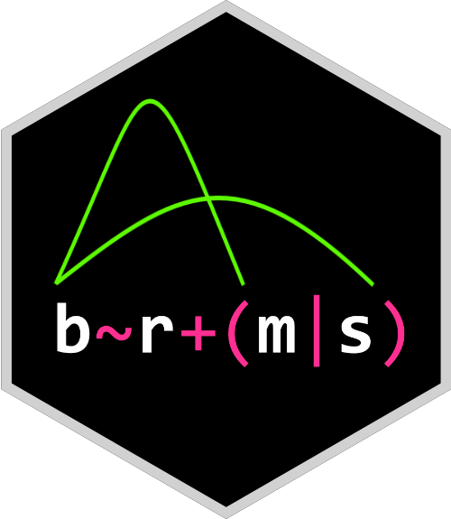

```{r}
#| echo: FALSE
#| output: FALSE
library(brms)
library(ggplot2)
library(dplyr)
theme_set(theme_bw(base_size = 24))
options(width = 120)
```

## {.unnumbered}

<br>

<br>

1. Statistical modeling & Bayesian inference

2. **Fitting nonlinear curves with `brms`**

3. Continuous & categorical treatment variables

4. Exercises


```{r}
#| echo: FALSE
#| fig-height: 8

library("BayesFR")
library("brms")

df = df_Hossie_and_Murray_2010_OECOLOGIA
df = subset(df, ID == "Figure 1a")
df$Feeding = df$NE
df$N = df$N0
```


## The `brms` package {.smaller}

:::: {.columns}
::: {.column width="70%"}

<br>

**B**ayesian **R**egression **M**odels using **S**tan

* Lets you define models conveniently in `lme4`-syntax
* Translates models to `Stan` & runs MCMC
* **Huge** variety of model classes:   
  * Classic LM, GLM, LMM, GLMM. Even GAM !     
  * Correlation structures: temporal, spatial, phylogenetic      
  * Many distribution families     
  * Multivariate models     
* Tools for plotting, model checking, predictions, hypothesis testing
* Compatible with packages like `emmeans`, `marginaleffects`, `DHARMa`

:::
::: {.column width="30%"}
{width="55%"}

{width="55%"} 

:::
::::

## Linear regression {.smaller}

:::: {.columns}

::: {.column width="50%"}


```{r}
#| echo: FALSE
#| output: FALSE
#| fig-height: 8

formula = bf(Feeding ~ N)

priors  = prior(normal(0,1), class="b")

fit.1   = brm(formula,
              prior = priors,
              data = df,
              backend = "cmdstan",
              file = "fit_example_2_1.rds")
```


```{r}
#| eval: FALSE
formula = bf(Feeding ~ N)

priors  = prior(normal(0,1), class="b")

fit.1   = brm(formula,
              prior = priors,
              data = df)

summary(fit.1)
```

```{r}
#| echo: FALSE
summary(fit.1)
```

:::


::: {.column width="5%"}
:::

::: {.column width="45%"}

<br>

```{r}
#| echo: FALSE
#| fig-height: 8
ggplot(df, aes(N, Feeding)) +
  geom_point(size = 2, alpha = 0.7) +
  labs(x = "Resource density N", y = "Feeding rate") +
  xlim(0,NA) +                                     
  ylim(0,NA) 
```

:::

::::


## Linear regression {.smaller}

:::: {.columns}

::: {.column width="50%"}


```{r}
#| eval: FALSE
formula = bf(Feeding ~ N)

priors  = prior(normal(0,1), class="b")

fit.1   = brm(formula,
              prior = priors,
              data = df)

summary(fit.1)
```

```{r}
#| echo: FALSE
summary(fit.1)
```

:::


::: {.column width="10%"}
:::

::: {.column width="40%"}

#### Check convergence
```{r}
#| fig-height: 8
plot(fit.1)
```

* `Rhat<1.01` ?
* Traceplots look like fuzzy caterpillars ? 

:::

::::

## Linear regression {.smaller}

:::: {.columns}

::: {.column width="50%"}


```{r}
#| eval: FALSE
formula = bf(Feeding ~ N)

priors  = prior(normal(0,1), class="b")

fit.1   = brm(formula,
              prior = priors,
              data = df)

summary(fit.1)
```

```{r}
#| echo: FALSE
summary(fit.1)
```

:::


::: {.column width="10%"}
:::

::: {.column width="40%"}

#### Check model fit

```{r}
#| fig-height: 8
#| output: FALSE
plot(conditional_effects(fit.1),
     points=TRUE)
```

```{r}
#| fig-height: 8
#| echo: FALSE
p1 = plot(conditional_effects(fit.1,
                              int_conditions=data.frame(N=seq(from=0, to=60, length.out=100))),
          points=TRUE, plot=FALSE)
p1[[1]] +
  scale_x_continuous(limits=c(0,NA)) +
  scale_y_continuous(limits=c(0,NA))
```

* Credible intervals for deterministic part       
$\mu(N)$

:::

::::

## Linear regression {.smaller}

:::: {.columns}

::: {.column width="50%"}


```{r}
#| eval: FALSE
formula = bf(Feeding ~ N)

priors  = prior(normal(0,1), class="b")

fit.1   = brm(formula,
              prior = priors,
              data = df)

summary(fit.1)
```

```{r}
#| echo: FALSE
summary(fit.1)
```

:::


::: {.column width="10%"}
:::

::: {.column width="40%"}

#### Check model fit

```{r}
#| fig-height: 8
#| output: FALSE
plot(conditional_effects(fit.1,
                         method="posterior_predict"),
     points=TRUE)
```

```{r}
#| fig-height: 8
#| echo: FALSE
p1 = plot(conditional_effects(fit.1,
                              method = "posterior_predict",
                              int_conditions=data.frame(N=seq(from=0, to=60, length.out=100))),
          points=TRUE, plot=FALSE)
p1[[1]] # +
# scale_x_continuous(limits=c(0,NA)) +
# scale_y_continuous(limits=c(0,NA))
```

* Prediction intervals det. & stoch. part   
$\text{Normal}(\mu(N),\sigma)$


:::

::::


## Linear regression {.smaller}

:::: {.columns}

::: {.column width="50%"}


```{r}
#| eval: FALSE
formula = bf(Feeding ~ N)

priors  = prior(normal(0,1), class="b")

fit.1   = brm(formula,
              prior = priors,
              data = df)

summary(fit.1)
```

```{r}
#| echo: FALSE
summary(fit.1)
```

:::


::: {.column width="10%"}
:::

::: {.column width="40%"}

#### Check model fit
```{r}
#| fig-height: 8
pp_check(fit.1, ndraws=200)
```

* Compare observed vs. predicted data

:::

::::


## Nonlinear model {.smaller}

:::: {.columns}

::: {.column width="50%"}


<div style="height: 32px;"></div>

#### Deterministic part: model formula

<div style="height: 32px;"></div>

$\mu(N) = \frac{\textcolor{#d62728}{\boldsymbol{F_\max}}\cdot N}{\textcolor{#d62728}{\boldsymbol{N_\text{\bf half}}}+N}$

<div style="height: 32px;"></div>

```{r}
#| eval: FALSE
formula = bf(Feeding ~ fmax*N/(nhalf+N),
             fmax ~ 1,
             nhalf ~ 1,
             nl = TRUE)
```

<div style="height: 32px;"></div>

* Write out formula as R-code     
  wrapped in `bf(..., nl=TRUE)`
* Original variable names: `N`, `Feeding`
* Custom parameter names: `fmax`, `nhalf`
* Parameters do not depend on additional predictors: `fmax~1, nhalf~1`

:::


::: {.column width="10%"}
:::

::: {.column width="40%"}

<br>

```{r}
#| echo: FALSE
#| fig-height: 8
ggplot(df, aes(N, Feeding)) +
  geom_point(size = 2, alpha = 0.7) +
  labs(x = "Resource density N", y = "Feeding rate") +
  xlim(0,NA) +                                     
  ylim(0,NA) 
```


:::

::::


## Nonlinear model {.smaller}

:::: {.columns}

::: {.column width="50%"}


<div style="height: 32px;"></div>

#### Priors

<div style="height: 32px;"></div>

$\mu(N)= \frac{\textcolor{#d62728}{\boldsymbol{F_\max}}\cdot N}{\textcolor{#d62728}{\boldsymbol{N_\text{\bf half}}}+N}$

<div style="height: 32px;"></div>

```{r}
#| eval: FALSE
priors = c(
  prior(normal(20,5), nlpar="fmax", lb=0),
  prior(normal(15,5), nlpar="nhalf", lb=0)
)
```

<div style="height: 32px;"></div>

* Specify (at least) weakly informative priors for every parameter
* If necessary, enforce positiveness with `lb=0`
* If you are unsure, use prior predictive checks `brm(..., sample_prior = "only")`

:::


::: {.column width="10%"}
:::

::: {.column width="40%"}

<br>

```{r}
#| echo: FALSE
#| fig-height: 8
ggplot(df, aes(N, Feeding)) +
  geom_point(size = 2, alpha = 0.7) +
  labs(x = "Resource density N", y = "Feeding rate") +
  xlim(0,NA) +                                     
  ylim(0,NA) 
```

:::

::::


## Nonlinear model {.smaller}

:::: {.columns}

::: {.column width="50%"}


<div style="height: 32px;"></div>

#### Stochastic part

<div style="height: 32px;"></div>

$\text{Feeding}_i \sim \operatorname{Poisson}\left( \mu\left( N_i\right)\right)$

<div style="height: 32px;"></div>

```{r}
#| eval: FALSE
brm(..., family = poisson(link="identity"))
```

<div style="height: 32px;"></div>

* Distribution of response values around mean prediction curve
* Is response    
  * unbounded or bounded, e.g. > 0 ?     
  * continuous or integer ?     
  * overdispersed ?    
* If nonlinear model predicts on correct scale,   
no link function required: `link="identity"`

:::

::: {.column width="10%"}
:::

::: {.column width="40%"}

<br>

```{r}
#| echo: FALSE
#| fig-height: 8
ggplot(df, aes(N, Feeding)) +
  geom_point(size = 2, alpha = 0.7) +
  labs(x = "Resource density N", y = "Feeding rate") +
  xlim(0,NA) +                                     
  ylim(0,NA) 
```

:::

::::


## Nonlinear model {.smaller}

:::: {.columns}

::: {.column width="50%"}


```{r}
#| echo: FALSE
#| output: FALSE
#| fig-height: 8

formula = bf(Feeding ~ fmax*N/(nhalf+N),
             fmax ~ 1,
             nhalf ~ 1,
             nl = TRUE)
priors  = c(
  prior(normal(20,5), nlpar="fmax", lb=0),
  prior(normal(15,5), nlpar="nhalf", lb=0)
)
fit.2   = brm(formula,
              prior = priors,
              family = poisson(link="identity"),
              data = df,
              backend = "cmdstan",
              file = "fit_example_2_2.rds")
```


```{r}
#| eval: FALSE
formula = bf(Feeding ~ fmax*N/(nhalf+N),
             fmax ~ 1,
             nhalf ~ 1,
             nl = TRUE)
priors  = c(
  prior(normal(20,5), nlpar="fmax", lb=0),
  prior(normal(15,5), nlpar="nhalf", lb=0)
)
fit.2   = brm(formula,
              prior = priors,
              family = poisson(link="identity"),
              data = df)

summary(fit.2)
```

```{r}
#| echo: FALSE
summary(fit.2)
```


:::

::: {.column width="10%"}
:::

::: {.column width="40%"}

<br>

```{r}
#| echo: FALSE
#| fig-height: 8
ggplot(df, aes(N, Feeding)) +
  geom_point(size = 2, alpha = 0.7) +
  labs(x = "Resource density N", y = "Feeding rate") +
  xlim(0,NA) +                                     
  ylim(0,NA) 
```

:::

::::


## Nonlinear model {.smaller}

:::: {.columns}

::: {.column width="50%"}


```{r}
#| eval: FALSE
formula = bf(Feeding ~ fmax*N/(nhalf+N),
             fmax ~ 1,
             nhalf ~ 1,
             nl = TRUE)
priors  = c(
  prior(normal(20,5), nlpar="fmax", lb=0),
  prior(normal(15,5), nlpar="nhalf", lb=0)
)
fit.2   = brm(formula,
              prior = priors,
              family = poisson(link="identity"),
              data = df)

summary(fit.2)
```

```{r}
#| echo: FALSE
summary(fit.2)
```

:::


::: {.column width="10%"}
:::

::: {.column width="40%"}

#### Check convergence
```{r}
#| fig-height: 8
plot(fit.2)
```

* `Rhat<1.01` ?
* Traceplots look like fuzzy caterpillars ? 

:::

::::


## Nonlinear model {.smaller}

:::: {.columns}

::: {.column width="50%"}


```{r}
#| eval: FALSE
formula = bf(Feeding ~ fmax*N/(nhalf+N),
             fmax ~ 1,
             nhalf ~ 1,
             nl = TRUE)
priors  = c(
  prior(normal(20,5), nlpar="fmax", lb=0),
  prior(normal(15,5), nlpar="nhalf", lb=0)
)
fit.2   = brm(formula,
              prior = priors,
              family = poisson(link="identity"),
              data = df)

summary(fit.2)
```

```{r}
#| echo: FALSE
summary(fit.2)
```

:::


::: {.column width="10%"}
:::

::: {.column width="40%"}

#### Check model fit

```{r}
#| fig-height: 8
#| output: FALSE
plot(conditional_effects(fit.2),
     points=TRUE)
```

```{r}
#| fig-height: 8
#| echo: FALSE
p1 = plot(conditional_effects(fit.2,
                              int_conditions=data.frame(N=seq(from=0, to=60, length.out=100))),
          points=TRUE, plot=FALSE)
p1[[1]] +
  scale_x_continuous(limits=c(0,NA)) +
  scale_y_continuous(limits=c(0,NA))
```


* Credible intervals for deterministic part       
$\mu(N)$


:::

::::

## Nonlinear model {.smaller}

:::: {.columns}

::: {.column width="50%"}


```{r}
#| eval: FALSE
formula = bf(Feeding ~ fmax*N/(nhalf+N),
             fmax ~ 1,
             nhalf ~ 1,
             nl = TRUE)
priors  = c(
  prior(normal(20,5), nlpar="fmax", lb=0),
  prior(normal(15,5), nlpar="nhalf", lb=0)
)
fit.2   = brm(formula,
              prior = priors,
              family = poisson(link="identity"),
              data = df)

summary(fit.2)
```

```{r}
#| echo: FALSE
summary(fit.2)
```

:::


::: {.column width="10%"}
:::

::: {.column width="40%"}

#### Check model fit

```{r}
#| fig-height: 8
#| output: FALSE
plot(conditional_effects(fit.2,
                         method="posterior_predict"),
     points=TRUE)
```

```{r}
#| fig-height: 8
#| echo: FALSE
p1 = plot(conditional_effects(fit.2,
                              method="posterior_predict",
                              int_conditions=data.frame(N=seq(from=0, to=60, length.out=100))),
          points=TRUE, plot=FALSE)
p1[[1]] +
  scale_x_continuous(limits=c(0,NA)) +
  scale_y_continuous(limits=c(0,NA))
```

* Prediction intervals det. & stoch. part   
$\text{Poisson}(\mu(N))$

:::

::::

<!---

## Nonlinear model {.smaller}

:::: {.columns}

::: {.column width="50%"}


```{r}
#| eval: FALSE
formula = bf(Feeding ~ fmax*N/(nhalf+N),
             fmax ~ 1,
             nhalf ~ 1,
             nl = TRUE)
priors  = c(
  prior(normal(20,5), nlpar="fmax", lb=0),
  prior(normal(15,5), nlpar="nhalf", lb=0)
)
fit.2   = brm(formula,
              prior = priors,
              family = poisson(link="identity"),
              data = df)

summary(fit.2)
```

```{r}
#| echo: FALSE
summary(fit.2)
```

:::


::: {.column width="10%"}
:::

::: {.column width="40%"}

#### Check model fit

```{r}
#| fig-height: 8
#| output: FALSE
plot(conditional_effects(fit.2, 
                         spaghetti = TRUE, 
                         ndraws = 200),
     points=TRUE)
```

```{r}
#| fig-height: 8
#| echo: FALSE
p1 = plot(conditional_effects(fit.2, spaghetti=TRUE, ndraws=200,
                              int_conditions=data.frame(N=seq(from=0, to=60, length.out=100))),
          points=TRUE, plot=FALSE)
p1[[1]] +
  scale_x_continuous(limits=c(0,NA)) +
  scale_y_continuous(limits=c(0,NA))
```

:::

::::

--->

## Nonlinear model {.smaller}

:::: {.columns}

::: {.column width="50%"}


```{r}
#| eval: FALSE
formula = bf(Feeding ~ fmax*N/(nhalf+N),
             fmax ~ 1,
             nhalf ~ 1,
             nl = TRUE)
priors  = c(
  prior(normal(20,5), nlpar="fmax", lb=0),
  prior(normal(15,5), nlpar="nhalf", lb=0)
)
fit.2   = brm(formula,
              prior = priors,
              family = poisson(link="identity"),
              data = df)

summary(fit.2)
```

```{r}
#| echo: FALSE
summary(fit.2)
```

:::


::: {.column width="10%"}
:::

::: {.column width="40%"}

#### Check model fit

```{r}
#| fig-height: 8
pp_check(fit.2, ndraws=200)
```

* Compare observed vs. predicted data

:::

::::

<!--

## Nonlinear model {.smaller}

:::: {.columns}

::: {.column width="50%"}


```{r}
#| eval: FALSE
formula = bf(Feeding ~ fmax*N/(nhalf+N),
             fmax ~ 1,
             nhalf ~ 1,
             nl = TRUE)
priors  = c(
  prior(normal(20,5), nlpar="fmax", lb=0),
  prior(normal(15,5), nlpar="nhalf", lb=0)
)
fit.2   = brm(formula,
              prior = priors,
              family = poisson(link="identity"),
              data = df)

summary(fit.2)
```

```{r}
#| echo: FALSE
summary(fit.2)
```

:::


::: {.column width="10%"}
:::

::: {.column width="40%"}

#### Check model fit

```{r}
#| fig-height: 8
pp_check(fit.2, ndraws=200, type="rootogram")
```

* Compare observed vs. predicted data

:::

::::

-->


## Nonlinear model {.smaller}


:::: {.columns}


::: {.column width="50%"}

<br>

#### Summary

<div style="height: 12px;"></div>

`brms` workflow similar for     
linear / generalized / nonlinear models:

1. Define statistical model
   * Deterministic part: **nonlinear function**
   * Stochastic part: distribution 
   * Priors
2. Run model
3. Check MCMC convergence
4. Check model fit

:::


::: {.column width="05%"}

:::


::: {.column width="45%"}

<br><br>

{width=80%}

::: {style="text-align: left; opacity: 0.6; font-size: 0.33em;"}
&nbsp;&nbsp;&nbsp;&nbsp;&nbsp;&nbsp;&nbsp;&nbsp;
&nbsp;&nbsp;&nbsp;&nbsp;&nbsp;&nbsp;&nbsp;&nbsp;
&nbsp;&nbsp;&nbsp;&nbsp;&nbsp;&nbsp;&nbsp;&nbsp;
&nbsp;&nbsp;&nbsp;&nbsp;&nbsp;&nbsp;&nbsp;&nbsp;
&nbsp;&nbsp;&nbsp;&nbsp;&nbsp;&nbsp;&nbsp;&nbsp;
&nbsp;&nbsp;&nbsp;&nbsp;&nbsp;&nbsp;&nbsp;&nbsp;
&nbsp;&nbsp;&nbsp;&nbsp;&nbsp;&nbsp;&nbsp;&nbsp;
https://www.magnific.com/de/autor/studiogstock 
:::


:::

::::

