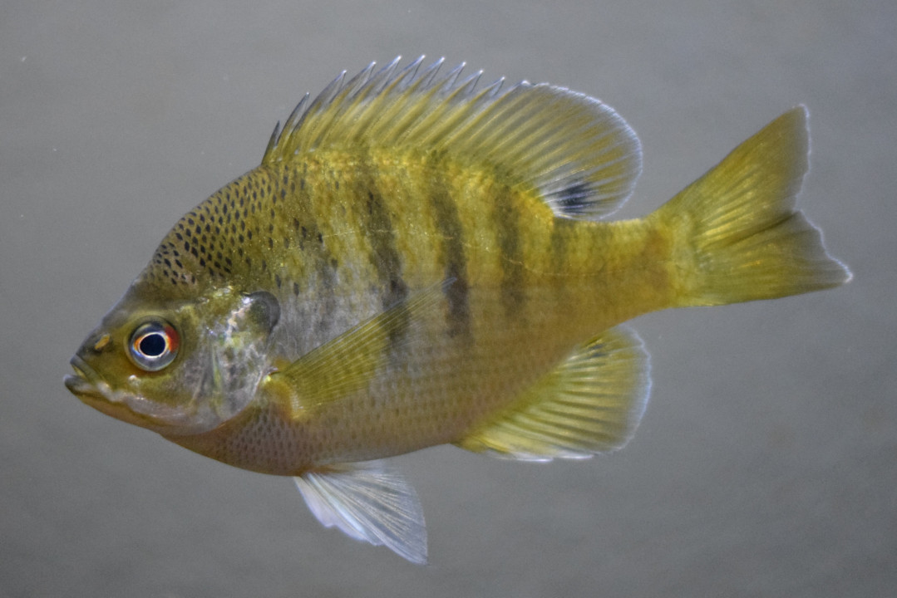

```{r}
#| echo: FALSE
#| output: FALSE
library(brms)
library(ggplot2)
library(dplyr)
library(BayesFR)
theme_set(theme_bw(base_size = 24))
options(width = 120)
```

## {.unnumbered}

<br>

<br>

1. Statistical modeling & Bayesian inference

2. Fitting nonlinear curves with `brms`

3. **Continuous & categorical treatment variables**

4. Exercises


## Categorical variable {.smaller}


:::: {.columns}

::: {.column width="50%"}

<div style="height: 32px;"></div>


::: {style="background-color:  var(--highlight-high-bg); border-left: 4px solid var(--highlight-high-border); padding: 0.5em; border-radius: 0 8px 8px 0;"}
**Hypothesis:** Predator size affects feeding rates.
:::

<div style="height: 32px;"></div>

Predator size is factor: small / medium / large

```{r}
library(BayesFR) # contains dataset
data(df_Cuthbert_et_al_2020_ECOL_EVOL)
df = subset(df_Cuthbert_et_al_2020_ECOL_EVOL, 
            Predator=="Lepomis macrochirus")
str(df)
```

:::

::: {.column width="05%"}
:::

::: {.column width="45%"}

<br>



::: {style="opacity: 0.6; font-size: 0.4em;"}
Source: https://commons.wikimedia.org/wiki/File:Bluegill_(fish).jpg CC BY-SA 4.0
:::


:::

::::

## Categorical variable {.smaller}


:::: {.columns}

::: {.column width="50%"}

<div style="height: 32px;"></div>


::: {style="background-color:  var(--highlight-high-bg); border-left: 4px solid var(--highlight-high-border); padding: 0.5em; border-radius: 0 8px 8px 0;"}
**Hypothesis:** Predator size affects feeding rates.
:::

<div style="height: 32px;"></div>

Predator size is factor: small / medium / large

```{r}
library(BayesFR) # contains dataset
data(df_Cuthbert_et_al_2020_ECOL_EVOL)
df = subset(df_Cuthbert_et_al_2020_ECOL_EVOL, 
            Predator=="Lepomis macrochirus")
str(df)
```

```{r}
#| echo: FALSE
df$Feeding = df$NE
df$N = df$N0
```

:::

::: {.column width="05%"}
:::

::: {.column width="45%"}

<br>

```{r}
#| echo: FALSE
#| fig-height: 8
set.seed(1701)
ggplot(aes(N,Feeding, color=PredSize), data=df) +
  geom_jitter(alpha=0.6, width=0.5, height=0.5, size=3) +
  theme(legend.position = "inside",
        legend.position.inside = c(0.15, 0.85),
        legend.background = element_rect(fill="lightgray", color="white")
  )
```

:::

::::


## Categorical variable {.smaller}


:::: {.columns}

::: {.column width="50%"}

<div style="height: 32px;"></div>

#### Deterministic part: model formula

<div style="height: 32px;"></div>

$\text{Feeding} = \frac{\textcolor{#d62728}{\boldsymbol{F_\max}}\cdot N}{\textcolor{#d62728}{\boldsymbol{N_\text{\bf half}}}+N}$

$F_\max=F_\max(\operatorname{PredSize})$

$N_\operatorname{half}=N_\operatorname{half}(\operatorname{PredSize})$

<div style="height: 32px;"></div>

```{r}
#| eval: FALSE
formula = bf(Feeding ~ fmax*N/(nhalf+N),
             fmax  ~ 0+PredSize,
             nhalf ~ 0+PredSize,
             nl = TRUE)
```

<div style="height: 32px;"></div>

* Make parameter(s) dependent on predictor
* Use classic `lm`-notation 
* `0+PredSize` prevents dummy-coding: parameters are $F_\max(\operatorname{small}), F_\max(\operatorname{medium}), F_\max(\operatorname{large})$ 

:::

::: {.column width="05%"}
:::

::: {.column width="45%"}

<br>

```{r}
#| echo: FALSE
#| fig-height: 8
set.seed(1701)
ggplot(aes(N,Feeding, color=PredSize), data=df) +
  geom_jitter(alpha=0.6, width=0.5, height=0.5, size=3) +
  theme(legend.position = "inside",
        legend.position.inside = c(0.15, 0.85),
        legend.background = element_rect(fill="lightgray", color="white")
  )
```

:::

::::


## Categorical variable {.smaller}


:::: {.columns}

::: {.column width="50%"}

<div style="height: 32px;"></div>

#### Priors

<div style="height: 32px;"></div>

$F_\max(\operatorname{small}), F_\max(\operatorname{medium}), F_\max(\operatorname{large})$

$N_\operatorname{half}(\operatorname{small}), N_\operatorname{half}(\operatorname{medium}), N_\operatorname{half}(\operatorname{large})$
<div style="height: 32px;"></div>

```{r}
#| eval: FALSE
priors = c(
  prior(normal(20,10), nlpar="fmax", lb=0),
  prior(normal(15,10), nlpar="nhalf", lb=0)
)
```

<div style="height: 32px;"></div>

* Identical priors across all levels of $\operatorname{PredSize}$
* Wide sdevs, weakly informative priors

:::

::: {.column width="05%"}
:::

::: {.column width="45%"}

<br>

```{r}
#| echo: FALSE
#| fig-height: 8
set.seed(1701)
ggplot(aes(N,Feeding, color=PredSize), data=df) +
  geom_jitter(alpha=0.6, width=0.5, height=0.5, size=3) +
  theme(legend.position = "inside",
        legend.position.inside = c(0.15, 0.85),
        legend.background = element_rect(fill="lightgray", color="white")
  )
```

:::

::::


## Categorical variable {.smaller}


:::: {.columns}

::: {.column width="50%"}


```{r}
#| echo: FALSE
#| output: FALSE
#| fig-height: 8

df$N = df$N0
df$Feeding = df$NE

formula = bf(Feeding ~ fmax*N/(nhalf+N),
             fmax  ~ 0+PredSize,
             nhalf ~ 0+PredSize,
             nl = TRUE)
priors = c(
  prior(normal(20,10), nlpar="fmax", lb=0),
  prior(normal(15,10), nlpar="nhalf", lb=0)
)
fit.1 = brm(formula,
            prior = priors,
            family = poisson(link="identity"),
            data = df,
            backend = "cmdstan",
            file = "fit_example_3_1.rds")
```


```{r}
#| eval: FALSE
fit.1 = brm(formula,
            prior = priors,
            family = poisson(link="identity"),
            data = df)

summary(fit.1)
```

```{r}
#| echo: FALSE
summary(fit.1)
```


:::

::: {.column width="05%"}
:::

::: {.column width="45%"}


```{r}
#| eval: FALSE
plot(conditional_effects(fit.1,
                         effects="N:PredSize"),
     points = TRUE)
```

```{r}
#| echo: FALSE
#| fig-height: 8
set.seed(1701)
p = plot(conditional_effects(fit.1,
                             effects="N:PredSize"),
         points = TRUE,
         point_args = list(alpha=0.5, width=0.5, height=0.5, size=2.5),
         plot = FALSE)
p[[1]] +   
  theme(legend.position = "inside",
        legend.position.inside = c(0.15, 0.85),
        legend.background = element_rect(fill="lightgray", color="white")
  )
```

:::

::::


## Categorical variable {.smaller}


:::: {.columns}

::: {.column width="50%"}


```{r}
#| echo: FALSE
#| output: FALSE
#| fig-height: 8

df$N = df$N0
df$Feeding = df$NE

formula = bf(Feeding ~ fmax*N/(nhalf+N),
             fmax  ~ 0+PredSize,
             nhalf ~ 0+PredSize,
             nl = TRUE)
priors = c(
  prior(normal(20,10), nlpar="fmax", lb=0),
  prior(normal(15,10), nlpar="nhalf", lb=0)
)
fit.1 = brm(formula,
            prior = priors,
            family = poisson(link="identity"),
            data = df,
            backend = "cmdstan",
            file = "fit_example_3_1.rds")
```


```{r}
#| eval: FALSE
fit.1 = brm(formula,
            prior = priors,
            family = poisson(link="identity"),
            data = df)

summary(fit.1)
```

```{r}
#| echo: FALSE
summary(fit.1)
```


:::

::: {.column width="05%"}
:::

::: {.column width="45%"}


```{r}
#| eval: FALSE
p = plot(conditional_effects(fit.1,
                             effects="N:PredSize"),
         points = TRUE, plot = FALSE)
p[[1]] + facet_wrap(~PredSize)    
```

```{r}
#| echo: FALSE
#| fig-height: 8
set.seed(1701)
p = plot(conditional_effects(fit.1,
                             effects="N:PredSize"),
         points = TRUE,
         point_args = list(alpha=0.5, width=0.5, size=1.5),
         plot = FALSE)
p[[1]] + 
  facet_wrap(~PredSize) +   
  theme(legend.position = "none")
```

:::

::::


## Categorical variable {.smaller}


:::: {.columns}

::: {.column width="50%"}

#### Means and contrasts


```{r}
library(emmeans)
em_fmax = emmeans(fit.1, ~ PredSize, nlpar = "fmax")
em_fmax
```
Here: same as fitted parameters

<div style="height: 32px;"></div>

```{r}
pairs(em_fmax) 
```
Uses full posterior distribution to compute differences


:::

::: {.column width="05%"}
:::

::: {.column width="45%"}

<div style="height: 1.5em;"></div>

```{r}
#| fig-height: 8
plot(conditional_effects(fit.1,
                         effects="PredSize",
                         nlpar="fmax"))
```

:::

::::

## Categorical variable {.smaller}


:::: {.columns}

::: {.column width="50%"}

#### Means and contrasts


```{r}
library(emmeans)
em_nhalf = emmeans(fit.1, ~ PredSize, nlpar = "nhalf")
em_nhalf
```
Here: same as fitted parameters

<div style="height: 32px;"></div>
```{r}
pairs(em_nhalf) 
```
Uses full posterior distribution to compute differences


:::

::: {.column width="05%"}
:::

::: {.column width="45%"}

<div style="height: 1.5em;"></div>

```{r}
#| fig-height: 8
plot(conditional_effects(fit.1,
                         effects="PredSize",
                         nlpar="nhalf"))
```

:::

::::


## Categorical variable {.smaller}


:::: {.columns}

::: {.column width="50%"}

#### Hypothesis testing

```{r}
hypothesis(fit.1, 
           "nhalf_PredSizelarge > nhalf_PredSizemedium")
```

<div style="height: 32px;"></div>

Posterior probability:

$P(N_\text{half}(\text{large})>N_\text{half}(\text{medium}))=0.85$

:::

::: {.column width="05%"}
:::

::: {.column width="45%"}

<div style="height: 1.5em;"></div>

```{r}
#| fig-height: 8
p = plot(
  hypothesis(fit.1,
             "nhalf_PredSizelarge > nhalf_PredSizemedium"),
  plot = FALSE
)
p[[1]] + geom_vline(xintercept=0)
```


:::

::::


## Categorical variable {.smaller}


:::: {.columns}

::: {.column width="50%"}

#### Model comparison


```{r}
#| echo: FALSE
#| output: FALSE
#| fig-height: 8

formula = bf(Feeding ~ fmax*N/(nhalf+N),
             fmax  ~ 1,
             nhalf ~ 1,
             nl = TRUE)
priors = c(
  prior(normal(20,10), nlpar="fmax", lb=0),
  prior(normal(15,10), nlpar="nhalf", lb=0)
)
fit.0 = brm(formula,
            prior = priors,
            family = poisson(link="identity"),
            data = df,
            backend = "cmdstan",
            file = "fit_example_3_2.rds")
```


```{r}
#| eval: FALSE
formula = bf(Feeding ~ fmax*N/(nhalf+N),
             fmax  ~ 1,
             nhalf ~ 1,
             nl = TRUE)
priors = c(
  prior(normal(20,10), nlpar="fmax", lb=0),
  prior(normal(15,10), nlpar="nhalf", lb=0)
)
fit.0 = brm(formula,
            prior = priors,
            family = poisson(link="identity"),
            data = df)
```

<div style="height: 32px;"></div>

* Define "null" model: remove predictor $\text{PredSize}$
* Test full model `fit.1` against null model `fit.0`
* Similar to ANOVA in linear models

:::

::: {.column width="05%"}
:::

::: {.column width="45%"}

<div style="height: 1.5em;"></div>

```{r}
#| eval: FALSE
plot(conditional_effects(fit.0,
                         effects="N"),
     points = TRUE)
```

```{r}
#| echo: FALSE
#| fig-height: 8
set.seed(1701)
plot(conditional_effects(fit.0,
                         effects="N"),
     points = TRUE)
```

:::

::::


## Categorical variable {.smaller}


:::: {.columns}

::: {.column width="50%"}

#### Model comparison


```{r}
#| echo: FALSE
#| output: FALSE
#| fig-height: 8

formula = bf(Feeding ~ fmax*N/(nhalf+N),
             fmax  ~ 1,
             nhalf ~ 1,
             nl = TRUE)
priors = c(
  prior(normal(20,10), nlpar="fmax", lb=0),
  prior(normal(15,10), nlpar="nhalf", lb=0)
)
fit.0 = brm(formula,
            prior = priors,
            family = poisson(link="identity"),
            data = df,
            backend = "cmdstan",
            file = "fit_example_3_2.rds")
```


```{r}
#| eval: FALSE
formula = bf(Feeding ~ fmax*N/(nhalf+N),
             fmax  ~ 1,
             nhalf ~ 1,
             nl = TRUE)
priors = c(
  prior(normal(20,10), nlpar="fmax", lb=0),
  prior(normal(15,10), nlpar="nhalf", lb=0)
)
fit.0 = brm(formula,
            prior = priors,
            family = poisson(link="identity"),
            data = df)
```

<div style="height: 32px;"></div>

* Define "null" model: remove predictor $\text{PredSize}$
* Test full model `fit.1` against null model `fit.0`
* Similar to ANOVA in linear models

:::

::: {.column width="05%"}
:::

::: {.column width="45%"}

<div style="height: 1.5em;"></div>

```{r}
#| eval: FALSE
LOO(fit.0, fit.1)
```

```{r}
#| echo: FALSE
#| fig-height: 8
loo0 = LOO(fit.0)
loo1 = LOO(fit.1)
loo_compare(loo0, loo1)
```

<div style="height: 32px;"></div>

* **L**eave-**O**ne-**O**ut cross validation
* Information criterion similar to AIC
* Ranks models by predictive accuracy `elpd`

<div style="height: 32px;"></div>

::: {style="background-color:  var(--highlight-high-bg); border-left: 4px solid var(--highlight-high-border); padding: 0.5em; border-radius: 0 8px 8px 0;"}
<span style="font-size: 1.0em;">
**→ `fit.1` performs better than `fit.0`**   
**→ Yes, feeding rates are affected by predator size.**
</span>
:::


:::

::::

## Categorical variable {.smaller}

<br>

#### Summary

* Define parameters depending on predictor according to research questions   
   E.g. not all parameters required to vary with predictor
* `par ~ factorA`&nbsp; puts linear model inside your nonlinear model
* `par ~ 0 + factorA`&nbsp; prevents dummy-coding, if just 1 factor
* Classical linear syntax for multiple factors    
  `par ~ factorA + factorB`    
  `par ~ factorA * factorB`
* Test full model against a null model&nbsp; `par ~ 1`&nbsp; using&nbsp; `LOO()`
* Individual contrasts between factor levels with&nbsp; `emmeans()` &nbsp;or&nbsp; `hypothesis()`