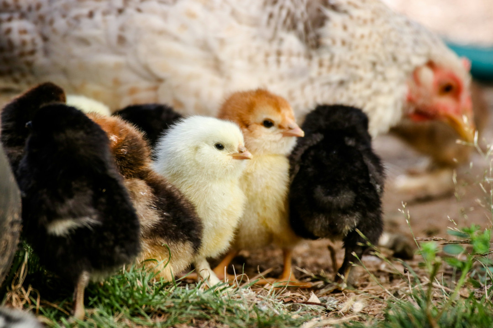
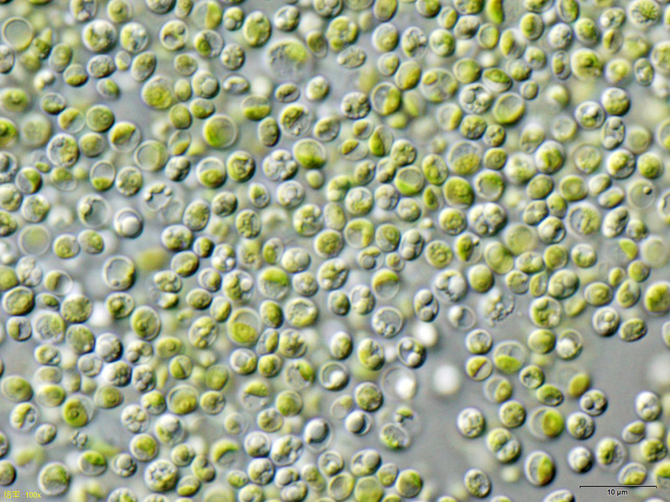

```{r}
#| echo: FALSE
#| output: FALSE
library(brms)
library(ggplot2)
library(dplyr)
library(BayesFR)
theme_set(theme_bw(base_size = 24))
options(width = 120)
```


## {.unnumbered}

<br>

<br>

1. Statistical modeling & Bayesian inference

2. Fitting nonlinear curves with `brms`

3. Continuous & categorical treatment variables

4. **Exercises**


## 1) Individual growth (basic) {.smaller}

:::: {.columns}

::: {.column width="50%"}

<div style="height: 60px;"></div>




:::

::: {.column width="05%"}
:::

::: {.column width="45%"}

<br>

```{r}
#| eval: FALSE
df = ChickWeight
ggplot(df, aes(x=Time, y=weight, col=Diet)) +
  geom_jitter(alpha=0.5, width=0.1, height=0) 
```


```{r}
#| fig-height: 8
#| echo: FALSE
set.seed(1701)
df = ChickWeight
p1 = ggplot(df, aes(x=Time, y=weight, col=Diet)) +
  geom_jitter(alpha=0.5, width=0.1, height=0) +
  theme(legend.position = "inside",
        legend.position.inside = c(0.1, 0.8),
        legend.background = element_rect(fill="lightgray", color="white")
  ) +
  scale_y_continuous(limits=c(0,NA))
p1
```

:::

::::

## 1) Individual growth (basic) {.smaller}

:::: {.columns}

::: {.column width="50%"}

<div style="height: 32px;"></div>

#### Logistic growth model

<div style="height: 32px;"></div>

$$\text{weight}(t) \sim  \frac{w_\max}{1+\left( \frac{w_\max}{w_0}-1\right) e^{-r\cdot t} } $$

$w_\max~$ maximum weight  

$w_0~~~~~$ initial weight  

$r~~~~~~~$ maximum growth rate  

<div style="height: 32px;"></div>
<div style="height: 32px;"></div>


Richards model family includes various individual weight growths model, defined by an exponent $d$:   
Logistic ($2$), Bertalanffy ($1.5$), Gompertz ($1$), ...

:::

::: {.column width="05%"}
:::

::: {.column width="45%"}

<br>

```{r}
#| eval: FALSE
df = ChickWeight
ggplot(df, aes(x=Time, y=weight, col=Diet)) +
  geom_jitter(alpha=0.5, width=0.1, height=0) 
```


```{r}
#| fig-height: 8
#| echo: FALSE
set.seed(1701)
p1
```


:::

::::


## 1) Individual growth (basic) {.smaller}

:::: {.columns}

::: {.column width="50%"}

<div style="height: 32px;"></div>

#### Exercises

* Model logistic growth function   
*Note: Choose appropriate distribution*
* Test the effect of factor `Diet` on growth.  
Which parameters should depend on `Diet` ?
* Dataset is collection of individual growth timeseries.  
Model `(1|Chick)` as random effect.  
Which parameters should depend on `Chick` ?   
*Note: might have to enforce positive parameters.*

:::

::: {.column width="05%"}
:::

::: {.column width="45%"}

<br>

::: {style="margin-right: -60px;"}
```{r}
#| eval: FALSE
df = ChickWeight
ggplot(df, aes(x=Time, y=weight, col=Diet, group=Chick)) +
  geom_line(alpha=0.5) 
```
:::

```{r}
#| fig-height: 8
#| echo: FALSE
set.seed(1701)
ggplot(df, aes(x=Time,y=weight,col=Diet,group=Chick)) +
  geom_line(alpha=0.5) +
  theme(legend.position = "inside",
        legend.position.inside = c(0.1, 0.8),
        legend.background = element_rect(fill="lightgray", color="white")
  ) +
  scale_y_continuous(limits=c(0,NA))
```


:::

::::


## 2) Thermal performance (advanced) {.smaller}

:::: {.columns}

::: {.column width="50%"}

<div style="height: 60px;"></div>



::: {style="opacity: 0.6; font-size: 0.4em;"}
Source: https://commons.wikimedia.org/wiki/File:Chlorella_vulgaris_NIES2170.jpg CC BY-SA 3.0
:::


:::

::: {.column width="05%"}
:::

::: {.column width="45%"}

<br>

```{r}
#| eval: FALSE
library("rTPC")
df = chlorella_tpc
df = subset(df, process=="adaptation" & flux=="photosynthesis")
ggplot(df, aes(x=temp, y=rate, col=growth_temp)) +
  geom_jitter(alpha=0.5, width=0.2, height=0) 
```


```{r}
#| fig-height: 8
#| echo: FALSE
set.seed(1701)
library("rTPC")
df = chlorella_tpc
df = subset(df, process=="adaptation" & flux=="photosynthesis")
ggplot(df, aes(x=temp, y=rate, col=growth_temp)) +
  geom_jitter(alpha=0.5, width=0.2, height=0) +
  theme(legend.position = "inside",
        legend.position.inside = c(0.15, 0.8),
        legend.background = element_rect(fill="lightgray", color="white")
  ) +
  scale_colour_viridis_c() +
  scale_y_continuous(limits=c(0,NA))
```

:::

::::


## 2) Thermal performance (advanced) {.smaller}

:::: {.columns}

::: {.column width="50%"}

<div style="height: 32px;"></div>

#### Sharpe-Schoolfield model

<div style="height: 32px;"></div>

$$\text{rate}(T) \sim  r_0 \frac{\exp \left(-\frac{E_a}{k}\left(\frac{1}{T}-\frac{1}{T_0} \right) \right)}{1+\exp \left(\frac{E_h}{k}\left(\frac{1}{T_h}-\frac{1}{T} \right) \right)}  $$
$k~~~$ Boltzman **constant**  

$T_0~$ reference temperature, **constant** [Kelvin]  

$r_0~~$ rate at $T_0$ 

$E_a~$ activation energy [eV]

$E_h~$ deactivation energy [eV]

$T_h~$ location (shortly after peak) [Kelvin]


:::

::: {.column width="05%"}
:::

::: {.column width="45%"}

<br>

```{r}
#| eval: FALSE
library("rTPC")
df = chlorella_tpc
df = subset(df, process=="adaptation" & flux=="photosynthesis")
ggplot(df, aes(x=temp, y=rate, col=growth_temp)) +
  geom_jitter(alpha=0.5, width=0.2, height=0) 
```


```{r}
#| fig-height: 8
#| echo: FALSE
set.seed(1701)
library("rTPC")
df = chlorella_tpc
df = subset(df, process=="adaptation" & flux=="photosynthesis")
ggplot(df, aes(x=temp, y=rate, col=growth_temp)) +
  geom_jitter(alpha=0.5, width=0.2, height=0) +
  theme(legend.position = "inside",
        legend.position.inside = c(0.15, 0.8),
        legend.background = element_rect(fill="lightgray", color="white")
  ) +
  scale_colour_viridis_c() +
  scale_y_continuous(limits=c(0,NA))
```

:::

::::


## 2) Thermal performance (advanced) {.smaller}

:::: {.columns}

::: {.column width="50%"}

<div style="height: 32px;"></div>

#### Exercise

<div style="height: 32px;"></div>

* Model photosynthesis rate with Sharpe-Schoolfield   
*Notes:*   
*Convert temperature to Kelvin in dataframe*      
*Supply constants as dataframe columns*   
*Set meaningful priors*   
*Might need to provide initial values* 
```{r}
#| eval: FALSE
init = list(b_Th=315, ...)
inits = rep(list(init), 4) # for 4 chains
```


:::

::: {.column width="05%"}
:::

::: {.column width="45%"}

<br>

```{r}
#| eval: FALSE
library("rTPC")
df = chlorella_tpc
df = subset(df, process=="adaptation" & flux=="photosynthesis")
ggplot(df, aes(x=temp, y=rate, col=growth_temp)) +
  geom_jitter(alpha=0.5, width=0.2, height=0) 
```


```{r}
#| fig-height: 8
#| echo: FALSE
set.seed(1701)
library("rTPC")
df = chlorella_tpc
df = subset(df, process=="adaptation" & flux=="photosynthesis")
ggplot(df, aes(x=temp, y=rate, col=growth_temp)) +
  geom_jitter(alpha=0.5, width=0.2, height=0) +
  theme(legend.position = "inside",
        legend.position.inside = c(0.15, 0.8),
        legend.background = element_rect(fill="lightgray", color="white")
  ) +
  scale_colour_viridis_c() +
  scale_y_continuous(limits=c(0,NA))
```

:::

::::


## 2) Thermal performance (advanced) {.smaller}

:::: {.columns}

::: {.column width="50%"}

<div style="height: 32px;"></div>

#### Exercise

<div style="height: 32px;"></div>

* Test if rate scales with acclimation temperature.   
  `r0 ~ scale(growth_temp)`   
  *Notes:*   
  *Ensure that $r_0$ stays positive*    
  *Look up parameter structure with `default_prior()`*    
  *Priors: $r_0$ now has intercept and slope*    
```{r}
#| eval: FALSE
prior = c(prior(normal(0,1), nlpar="logr0", coef="Intercept"), 
          prior(normal(0,1), nlpar="logr0", coef="scalegrowth_temp"),
          ...)
```
$~~$ *Inits: both can be supplied in a vector for $r_0$*
```{r}
#| eval: FALSE
init = list(b_logr0=c(0,-0.5), ...)
```


:::

::: {.column width="05%"}
:::

::: {.column width="45%"}

<br>

```{r}
#| eval: FALSE
library("rTPC")
df = chlorella_tpc
df = subset(df, process=="adaptation" & flux=="photosynthesis")
ggplot(df, aes(x=temp, y=rate, col=growth_temp)) +
  geom_jitter(alpha=0.5, width=0.2, height=0) 
```


```{r}
#| fig-height: 8
#| echo: FALSE
set.seed(1701)
library("rTPC")
df = chlorella_tpc
df = subset(df, process=="adaptation" & flux=="photosynthesis")
ggplot(df, aes(x=temp, y=rate, col=growth_temp)) +
  geom_jitter(alpha=0.5, width=0.2, height=0) +
  theme(legend.position = "inside",
        legend.position.inside = c(0.15, 0.8),
        legend.background = element_rect(fill="lightgray", color="white")
  ) +
  scale_colour_viridis_c() +
  scale_y_continuous(limits=c(0,NA))
```

:::

::::


## 2) Thermal performance (advanced) {.smaller}

:::: {.columns}

::: {.column width="50%"}

<div style="height: 32px;"></div>

#### Exercise

<div style="height: 32px;"></div>

* Test if temperature optimum changes with acclimation temperature, by making all parameters depend on `growth_temp`
  

:::

::: {.column width="05%"}
:::

::: {.column width="45%"}

<br>

```{r}
#| eval: FALSE
library("rTPC")
df = chlorella_tpc
df = subset(df, process=="adaptation" & flux=="photosynthesis")
ggplot(df, aes(x=temp, y=rate, col=growth_temp)) +
  geom_jitter(alpha=0.5, width=0.2, height=0) 
```


```{r}
#| fig-height: 8
#| echo: FALSE
set.seed(1701)
library("rTPC")
df = chlorella_tpc
df = subset(df, process=="adaptation" & flux=="photosynthesis")
ggplot(df, aes(x=temp, y=rate, col=growth_temp)) +
  geom_jitter(alpha=0.5, width=0.2, height=0) +
  theme(legend.position = "inside",
        legend.position.inside = c(0.15, 0.8),
        legend.background = element_rect(fill="lightgray", color="white")
  ) +
  scale_colour_viridis_c() +
  scale_y_continuous(limits=c(0,NA))
```

:::

::::
